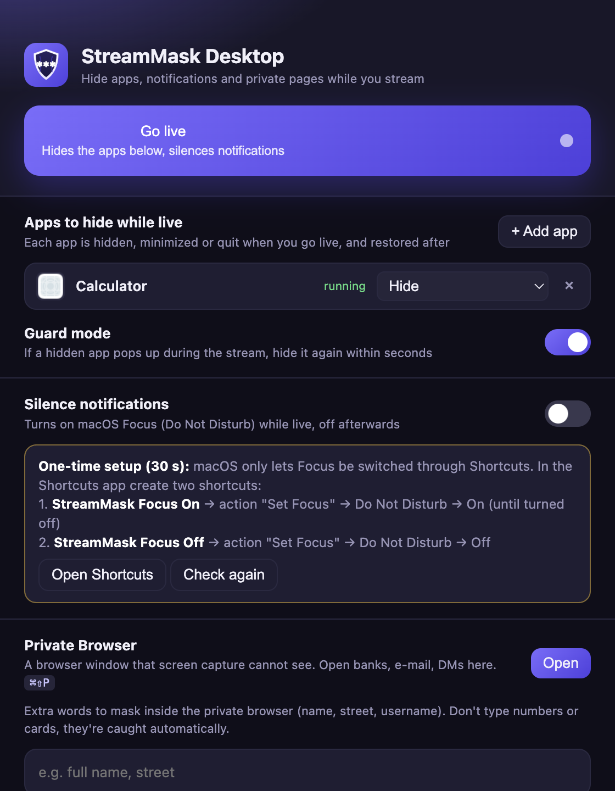

# StreamMask Desktop

Open-source stream privacy tool for macOS. One click before you go live:

- **Hides the apps you choose** (WhatsApp, Mail, Telegram, Discord, Slack…) – hide, minimize or quit, and restores them when the stream ends.
- **Guard mode** – if a hidden app pops up during the stream, it is hidden again within seconds.
- **Hide windows by title** – a window whose title contains text you listed is minimized while live and restored after. For hiding one mail window or one bank tab without hiding the whole app. Titles are never written to the activity log, since a title like "Inbox — you@example.com" is itself the thing you are hiding.
- **Hide desktop icons** (optional) – files and folders on your Desktop disappear while live and come back when you end.
- **Silences notifications** – switches macOS Focus (Do Not Disturb) on while live, off afterwards.
- **Private Browser** – a browser window that **screen capture cannot see**. Open your bank, e-mail or DMs there; OBS, Discord, Zoom, Meet and macOS screen recording show nothing, even when you share the whole screen. Personal info on pages inside it is masked there too, with the same engine as the [StreamMask Chrome extension](https://github.com/KursadEren/streammask): phone numbers, e-mails, ID numbers for ten countries, IBANs, cards, IP addresses, API keys and tokens, and your own words — inside Shadow DOM as well. You choose the categories, the countries and how masks look (`*****`, same length, last 4, or a label) in the control panel.
- **Browser extension bridge** – pairs with the [StreamMask Chrome extension](https://github.com/KursadEren/streammask) so one switch covers both: going live here turns masking and Stream Mode on in Chrome, and turning Stream Mode on in the browser hides the apps here. Turn it on in the control panel and paste the pairing code into the extension popup.
- StreamMask's own windows are excluded from capture too.

Nothing leaves your machine: no server, no accounts, no analytics. Settings live in a local JSON file.



## Install

Download the latest `.dmg` from [Releases](https://github.com/KursadEren/streammask-desktop/releases), drag StreamMask Desktop to Applications.
The app is not notarized yet; on first launch right-click → Open, or run `xattr -dr com.apple.quarantine "/Applications/StreamMask Desktop.app"`.

### Permissions (macOS asks once)
- **Automation → System Events** and **Accessibility**: needed to hide / minimize / quit other apps. macOS shows the prompt the first time you go live.
- **Focus**: macOS has no public API for Do Not Disturb, so StreamMask runs two Shortcuts you create once (30 seconds): `StreamMask Focus On` (Set Focus → Do Not Disturb → On until turned off) and `StreamMask Focus Off` (Set Focus → Do Not Disturb → Off). The panel tells you when they are detected.

## Browser extension bridge
The app listens on `127.0.0.1:47811` only, and every connection must present the pairing code shown in the control panel (any web page can open a WebSocket to localhost, so the code is what keeps strangers out). Press **New** to rotate the code; connected extensions then have to be paired again. Turn the bridge off and the port is closed.

## Shortcuts
- `⌘⇧L` go live / end stream
- `⌘⇧P` show / hide the Private Browser
- Inside the Private Browser: `⌘T` new tab, `⌘W` close tab, `⌘L` address bar, `⌘R` reload

## Is the Private Browser safe?
Pages inside it run in Chromium's normal sandbox with Node integration off and context isolation on: a website cannot read your files, other windows or anything on the computer. The only code StreamMask injects is the masking script, which runs inside the page and sends nothing anywhere.

## How the invisibility works
The Private Browser window is created with content protection (`NSWindow.sharingType = .none` on macOS, `WDA_EXCLUDEFROMCAPTURE` on Windows). Screen-capture APIs skip such windows entirely: they are blank or absent in recordings and shares, while you see them normally on your monitor.

Limits: an HDMI capture card or a camera pointed at the monitor still sees everything. Existing tabs in your normal Chrome cannot be hidden – open sensitive sites in the Private Browser instead.

## Masking engine
`src/content/` is generated, not hand-written: it is copied from the browser extension with `npm run sync-engine`. Keeping two copies by hand is what made the desktop version fall behind before, with fixed bugs still living on in it. Point it elsewhere with `STREAMMASK_EXT=/path/to/streammask npm run sync-engine`; `src/content/ENGINE_VERSION` records which extension version is in there.

## Run from source
```bash
npm install
npm start
```
Build a `.dmg`: `npm run dist` (output in `dist/`).

## Windows
The same content-protection call exists on Windows 10 2004+; app hiding uses different APIs and is not implemented yet. Contributions welcome.

## License
MIT
